# One Cluster, Many Front Doors: How We Use Istio Gateways to Group and Isolate Apps in Production

*A real-world walkthrough: from a single "everything ingress" to dedicated Istio gateways, zero-trust between teams, and safe canary releases, with every manifest included.*

---

## TL;DR

- One shared ingress for every app is fine on day one and becomes a liability by day 300. Payments, partner APIs, back-office tools and the public website do **not** have the same risk, scale or audience.
- Istio lets you run **several gateways in the same cluster**. Each is its own Envoy deployment with its own load balancer, certificates, scaling and policies, so you can **group** apps that belong together and **split** the ones that must never touch.
- With the **Kubernetes Gateway API** (`allowedRoutes`), a gateway decides which namespaces may attach to it. A developer in `storefront` *cannot* accidentally publish an app on the payments domain.
- Inside the mesh, **mTLS + AuthorizationPolicy** turn "the network is flat" into "only these identities may talk to these apps".
- Bonus: the same building blocks give you **weighted canary releases** for free.

---

## 1. The scenario: GlobeMart, a worldwide e-commerce platform

To keep this concrete, let's use a setup most of us have seen in some form. **GlobeMart** sells online in Europe, the Americas and Asia. Its Kubernetes platform hosts four families of applications:

| Domain | Apps | Audience | Risk / constraints |
|---|---|---|---|
| **Storefront** | `frontend`, `catalog`, `cart` | Everyone on the internet | Huge traffic spikes (Black Friday), must stay fast |
| **Checkout / Payments** | `checkout`, `payments` | Customers paying | PCI-DSS scope: must be isolated, audited and minimal |
| **Partners (B2B)** | `partner-api` | Marketplace sellers, logistics carriers | Must authenticate partners with client certificates |
| **Back-office** | `admin`, `grafana`, `kibana` | Employees only | Must never be reachable from the internet |

### The problem: one ingress to rule them all

Like many teams, GlobeMart started with a single ingress controller and one public load balancer. Every team added its hostname to it.


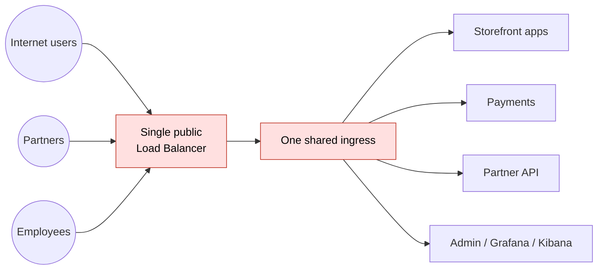

What went wrong over time:

1. **Blast radius.** A bad config pushed by the storefront team (a broken regex, a huge header) reloaded the shared ingress and took **payments** down with it.
2. **Noisy neighbours.** During a marketing campaign the storefront saturated the ingress pods, and partners' API calls started timing out.
3. **Compliance.** Auditors asked "which components handle card data?". The honest answer was "the shared ingress, which is also used by 40 other apps", which put far more of the platform in PCI scope.
4. **Exposure.** `admin.globemart.example` was "protected" only by an IP allowlist annotation on a public load balancer. One typo away from the internet.
5. **Ownership.** Anyone with access to any namespace could create an ingress rule for any hostname.

The fix wasn't "more clusters". It was **more front doors, each with a clear purpose**, plus **identity-based rules inside**. That's exactly what Istio is good at.

---

## 2. Istio in 2 minutes (only what you need for this article)

Istio is a service mesh. For our purposes it gives three things:

- **istiod**: the control plane. It watches Kubernetes resources and pushes configuration to every proxy.
- **Envoy sidecars** next to every app pod: they handle mTLS, retries, metrics and policy for traffic *between* services (east-west).
- **Gateways**: standalone Envoy deployments at the edge of the mesh that handle traffic *entering or leaving* it (north-south).


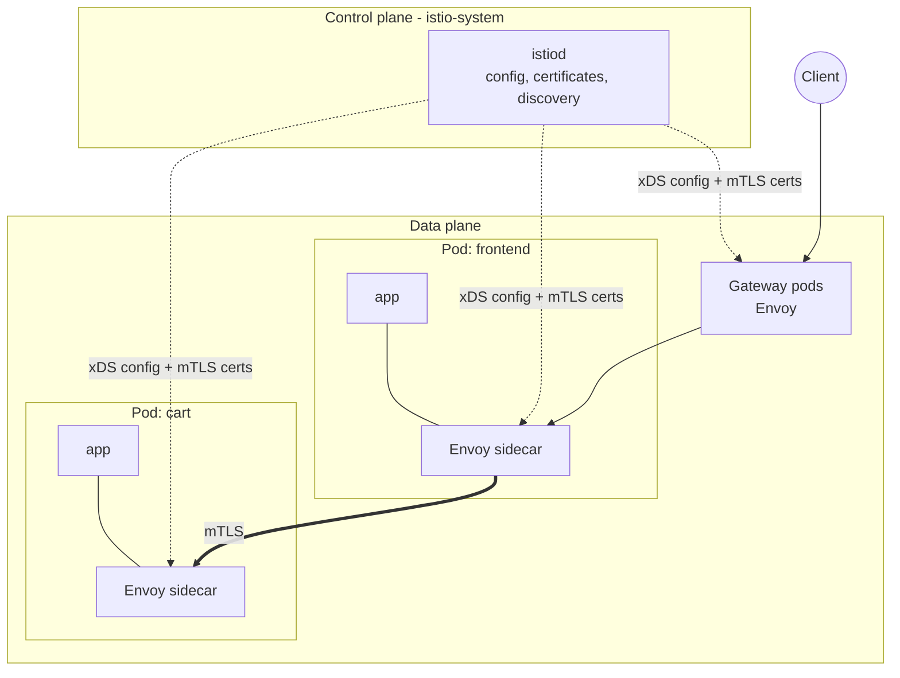

The key insight for this article: **a gateway is just a Deployment + a Service**. Nothing stops you from running five of them, each in its own namespace, on its own nodes, with its own load balancer.

> **Sidecar or ambient?** Istio also offers *ambient mode* (no sidecars; a per-node `ztunnel` plus optional waypoint proxies). Everything about gateways and authorization in this article works with both. I use sidecar mode in the examples because it is still the most common setup in production clusters today.

---

## 3. The target architecture

GlobeMart's new design uses **four ingress gateways** and controlled **egress**:

| Gateway | Namespace | Load balancer | Hostnames | Who can attach routes |
|---|---|---|---|---|
| `public-gw` | `istio-ingress-public` | Public | `www.`, `api.globemart.example` | namespaces labelled `exposure=public` |
| `payments-gw` | `istio-ingress-pci` | Public, dedicated nodes | `pay.globemart.example` | only the `checkout` namespace |
| `partners-gw` | `istio-ingress-partners` | Public, mutual TLS | `partners.globemart.example` | only the `partners` namespace |
| `internal-gw` | `istio-ingress-internal` | **Private (VPC only)** | `*.internal.globemart.example` | namespaces labelled `exposure=internal` |


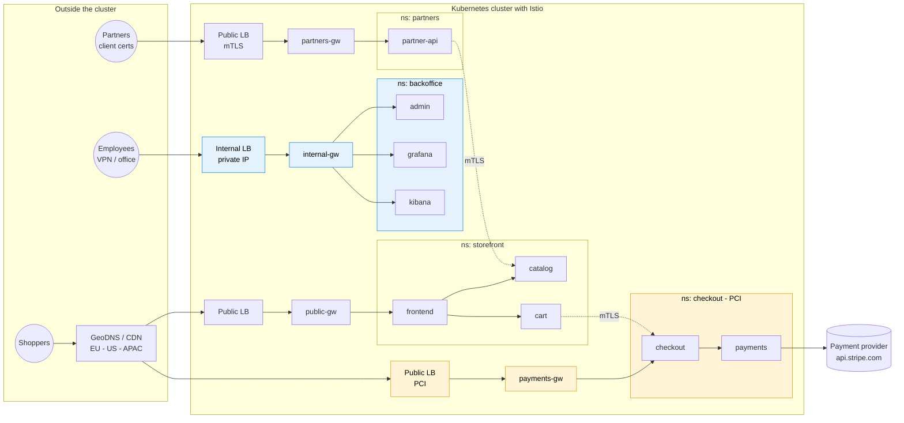

**Grouping**: `frontend`, `catalog` and `cart` share one gateway because they share an audience, a scaling profile and a risk level. Same for the back-office tools.

**Splitting**: payments gets its own gateway, nodes and certificates; partners get a gateway that *requires* a client certificate; back-office tools sit behind a gateway that has no public IP at all.

Why this helps:

- A broken storefront route can only break `public-gw`, so **payments stays up**.
- `public-gw` can scale to 50 replicas on Black Friday without touching anyone else.
- The PCI scope shrinks to `payments-gw` + the `checkout` namespace + its nodes.
- `grafana` and `kibana` are physically unreachable from the internet, not just "filtered".

---

## 4. Install Istio (production-style, with Helm)

> Tested pattern for Istio **1.31** (the current release line at the time of writing) on Kubernetes 1.32+. Check [istio.io](https://istio.io/latest/news/releases/) for the latest patch version and use it.

### 4.1 Gateway API CRDs

Istio implements the Kubernetes Gateway API, which is now the recommended way to configure gateways. Install the CRDs first, using the Gateway API version listed in your Istio release notes:

```bash
kubectl get crd gateways.gateway.networking.k8s.io &> /dev/null || \
  kubectl kustomize "github.com/kubernetes-sigs/gateway-api/config/crd?ref=v1.4.0" | kubectl apply -f -
```

### 4.2 Control plane

```bash
export ISTIO_VERSION=1.31.0   # pin it; never install "latest" in prod

helm repo add istio https://istio-release.storage.googleapis.com/charts
helm repo update

helm install istio-base istio/base -n istio-system --create-namespace \
  --version "$ISTIO_VERSION"

helm install istiod istio/istiod -n istio-system \
  --version "$ISTIO_VERSION" -f istiod-values.yaml --wait
```

`istiod-values.yaml`, the settings that matter on day one:

```yaml
# file: istiod-values.yaml
pilot:
  autoscaleEnabled: true
  autoscaleMin: 2            # never run a single istiod in prod
  autoscaleMax: 5
  resources:
    requests:
      cpu: 500m
      memory: 2Gi

meshConfig:
  accessLogFile: /dev/stdout          # access logs for every proxy
  accessLogEncoding: JSON             # easy to ship to ELK / Loki
  outboundTrafficPolicy:
    mode: REGISTRY_ONLY               # pods can only call known destinations
  defaultConfig:
    holdApplicationUntilProxyStarts: true   # no "connection refused" at pod start
```

> ⚠️ **About `REGISTRY_ONLY`:** it blocks every outbound call to a host the mesh doesn't know. That's what you want for PCI, but on an *existing* cluster start with `ALLOW_ANY`, look at the access logs for `BlackHoleCluster`, declare the legitimate external hosts with `ServiceEntry` resources, and only then switch.

### 4.3 Namespaces

Labels do two jobs here: they turn on sidecar injection, and they decide which gateway a namespace may use (section 5).

```yaml
# file: 00-namespaces.yaml
apiVersion: v1
kind: Namespace
metadata:
  name: storefront
  labels:
    istio-injection: enabled
    exposure: public
---
apiVersion: v1
kind: Namespace
metadata:
  name: checkout
  labels:
    istio-injection: enabled
    exposure: pci
---
apiVersion: v1
kind: Namespace
metadata:
  name: partners
  labels:
    istio-injection: enabled
    exposure: partners
---
apiVersion: v1
kind: Namespace
metadata:
  name: backoffice
  labels:
    istio-injection: enabled
    exposure: internal
---
apiVersion: v1
kind: Namespace
metadata:
  name: istio-ingress-public
---
apiVersion: v1
kind: Namespace
metadata:
  name: istio-ingress-pci
---
apiVersion: v1
kind: Namespace
metadata:
  name: istio-ingress-partners
---
apiVersion: v1
kind: Namespace
metadata:
  name: istio-ingress-internal
```

```bash
kubectl apply -f 00-namespaces.yaml
# restart existing workloads so they get their sidecar
kubectl rollout restart deployment -n storefront
```

**Why one namespace per gateway?** RBAC. The platform team owns `istio-ingress-*`; application teams own their app namespaces. TLS certificates live next to the gateway that uses them, and a developer in `storefront` can't read the payments certificate.

---

## 5. The gateways: grouping and splitting apps

With the Gateway API, creating a `Gateway` resource with `gatewayClassName: istio` makes Istio **automatically deploy** a dedicated Envoy Deployment, Service (load balancer), and ServiceAccount named `<gateway-name>-istio`. One YAML gives you one front door.

### 5.1 Who owns what: the separation of roles

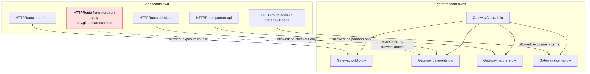

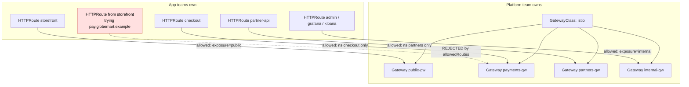

This is the heart of the design. **The gateway declares which namespaces may attach routes to it** (`allowedRoutes`). App teams keep full autonomy over their own routing, but only on the front door they're entitled to.

### 5.2 `public-gw`: the storefront group

```yaml
# file: 10-gateway-public.yaml
apiVersion: gateway.networking.k8s.io/v1
kind: Gateway
metadata:
  name: public-gw
  namespace: istio-ingress-public
spec:
  gatewayClassName: istio
  infrastructure:
    parametersRef:              # replicas, HPA, PDB for this gateway only
      group: ""
      kind: ConfigMap
      name: public-gw-options
  listeners:
    - name: http
      port: 80
      protocol: HTTP
      allowedRoutes:
        namespaces:
          from: Same            # only the redirect route below
    - name: https
      port: 443
      protocol: HTTPS
      hostname: "*.globemart.example"
      tls:
        mode: Terminate
        certificateRefs:
          - kind: Secret
            name: globemart-wildcard-tls   # e.g. issued by cert-manager
      allowedRoutes:
        namespaces:
          from: Selector
          selector:
            matchLabels:
              exposure: public
---
apiVersion: v1
kind: ConfigMap
metadata:
  name: public-gw-options
  namespace: istio-ingress-public
data:
  horizontalPodAutoscaler: |
    spec:
      minReplicas: 3
      maxReplicas: 50
  podDisruptionBudget: |
    spec:
      minAvailable: 2
---
# Redirect all HTTP to HTTPS
apiVersion: gateway.networking.k8s.io/v1
kind: HTTPRoute
metadata:
  name: http-to-https
  namespace: istio-ingress-public
spec:
  parentRefs:
    - name: public-gw
      sectionName: http
  rules:
    - filters:
        - type: RequestRedirect
          requestRedirect:
            scheme: https
            statusCode: 301
```

> One catch: the `*.globemart.example` wildcard also matches `pay.` and `partners.`, but because `checkout` and `partners` namespaces don't carry `exposure: public`, they can't attach here. The selector is the guardrail, not the hostname.

The storefront team then owns their routing:

```yaml
# file: 20-route-storefront.yaml
apiVersion: gateway.networking.k8s.io/v1
kind: HTTPRoute
metadata:
  name: storefront
  namespace: storefront
spec:
  parentRefs:
    - name: public-gw
      namespace: istio-ingress-public
      sectionName: https
  hostnames:
    - www.globemart.example
    - api.globemart.example
  rules:
    - matches:
        - path: { type: PathPrefix, value: /api/catalog }
      backendRefs:
        - name: catalog
          port: 8080
    - matches:
        - path: { type: PathPrefix, value: /api/cart }
      backendRefs:
        - name: cart
          port: 8080
      timeouts:
        request: 5s
    - matches:
        - path: { type: PathPrefix, value: / }
      backendRefs:
        - name: frontend
          port: 8080
```

### 5.3 `payments-gw`: split out, on dedicated nodes

Same pattern, but strict: only the `checkout` namespace can attach, and the gateway pods run on a dedicated, tainted node pool that holds nothing else.

```yaml
# file: 11-gateway-payments.yaml
apiVersion: gateway.networking.k8s.io/v1
kind: Gateway
metadata:
  name: payments-gw
  namespace: istio-ingress-pci
spec:
  gatewayClassName: istio
  infrastructure:
    labels:
      compliance: pci
    parametersRef:
      group: ""
      kind: ConfigMap
      name: payments-gw-options
  listeners:
    - name: https
      port: 443
      protocol: HTTPS
      hostname: pay.globemart.example
      tls:
        mode: Terminate
        certificateRefs:
          - kind: Secret
            name: pay-globemart-tls        # its own cert, not the wildcard
      allowedRoutes:
        namespaces:
          from: Selector
          selector:
            matchLabels:
              kubernetes.io/metadata.name: checkout
---
apiVersion: v1
kind: ConfigMap
metadata:
  name: payments-gw-options
  namespace: istio-ingress-pci
data:
  horizontalPodAutoscaler: |
    spec:
      minReplicas: 3
      maxReplicas: 10
  podDisruptionBudget: |
    spec:
      minAvailable: 2
  deployment: |
    spec:
      template:
        spec:
          nodeSelector:
            node-pool: pci
          tolerations:
            - key: dedicated
              operator: Equal
              value: pci
              effect: NoSchedule
---
apiVersion: gateway.networking.k8s.io/v1
kind: HTTPRoute
metadata:
  name: checkout
  namespace: checkout
spec:
  parentRefs:
    - name: payments-gw
      namespace: istio-ingress-pci
  hostnames:
    - pay.globemart.example
  rules:
    - backendRefs:
        - name: checkout
          port: 8080
      timeouts:
        request: 15s
```

### 5.4 `partners-gw`: mutual TLS for B2B

Partners must present a client certificate signed by GlobeMart's partner CA. Istio supports this on Gateway API listeners through a TLS option; the CA goes in the `ca.crt` key of the same secret.

```yaml
# file: 12-gateway-partners.yaml
apiVersion: gateway.networking.k8s.io/v1
kind: Gateway
metadata:
  name: partners-gw
  namespace: istio-ingress-partners
spec:
  gatewayClassName: istio
  listeners:
    - name: https-mtls
      port: 443
      protocol: HTTPS
      hostname: partners.globemart.example
      tls:
        mode: Terminate
        certificateRefs:
          - kind: Secret
            name: partners-tls          # tls.crt, tls.key AND ca.crt (partner CA)
        options:
          gateway.istio.io/tls-terminate-mode: MUTUAL
      allowedRoutes:
        namespaces:
          from: Selector
          selector:
            matchLabels:
              kubernetes.io/metadata.name: partners
---
apiVersion: gateway.networking.k8s.io/v1
kind: HTTPRoute
metadata:
  name: partner-api
  namespace: partners
spec:
  parentRefs:
    - name: partners-gw
      namespace: istio-ingress-partners
  hostnames:
    - partners.globemart.example
  rules:
    - backendRefs:
        - name: partner-api
          port: 8080
```

### 5.5 `internal-gw`: the back-office group, never on the internet

The trick is a single annotation passed to the generated Service, which makes the cloud provider create a **private** load balancer. Pick the line for your cloud:

```yaml
# file: 13-gateway-internal.yaml
apiVersion: gateway.networking.k8s.io/v1
kind: Gateway
metadata:
  name: internal-gw
  namespace: istio-ingress-internal
spec:
  gatewayClassName: istio
  infrastructure:
    annotations:
      # AWS
      service.beta.kubernetes.io/aws-load-balancer-scheme: internal
      # GKE:   networking.gke.io/load-balancer-type: "Internal"
      # Azure: service.beta.kubernetes.io/azure-load-balancer-internal: "true"
  listeners:
    - name: https
      port: 443
      protocol: HTTPS
      hostname: "*.internal.globemart.example"
      tls:
        mode: Terminate
        certificateRefs:
          - kind: Secret
            name: internal-wildcard-tls
      allowedRoutes:
        namespaces:
          from: Selector
          selector:
            matchLabels:
              exposure: internal
---
apiVersion: gateway.networking.k8s.io/v1
kind: HTTPRoute
metadata:
  name: backoffice-tools
  namespace: backoffice
spec:
  parentRefs:
    - name: internal-gw
      namespace: istio-ingress-internal
  hostnames: [admin.internal.globemart.example]
  rules:
    - backendRefs: [{ name: admin, port: 8080 }]
---
apiVersion: gateway.networking.k8s.io/v1
kind: HTTPRoute
metadata:
  name: grafana
  namespace: backoffice
spec:
  parentRefs:
    - name: internal-gw
      namespace: istio-ingress-internal
  hostnames: [grafana.internal.globemart.example]
  rules:
    - backendRefs: [{ name: grafana, port: 3000 }]
---
apiVersion: gateway.networking.k8s.io/v1
kind: HTTPRoute
metadata:
  name: kibana
  namespace: backoffice
spec:
  parentRefs:
    - name: internal-gw
      namespace: istio-ingress-internal
  hostnames: [kibana.internal.globemart.example]
  rules:
    - backendRefs: [{ name: kibana, port: 5601 }]
```

### 5.6 Check that everything is wired

```bash
kubectl get gateway -A
# NAME          CLASS   ADDRESS          PROGRAMMED
# public-gw     istio   34.x.x.x         True
# payments-gw   istio   35.x.x.x         True
# partners-gw   istio   35.y.y.y         True
# internal-gw   istio   10.20.0.15       True     <- private IP

kubectl get httproute -A
# Look at the status: a route rejected by allowedRoutes reports
# Accepted=False with reason NotAllowedByListeners.
kubectl describe httproute -n storefront storefront
```

Try the guardrail yourself. Create an `HTTPRoute` in `storefront` pointing at `payments-gw`: its status will show `NotAllowedByListeners`, and no traffic will flow.

---

## 6. Following one request through the system

Here's what happens when a customer adds an item to the cart and pays:

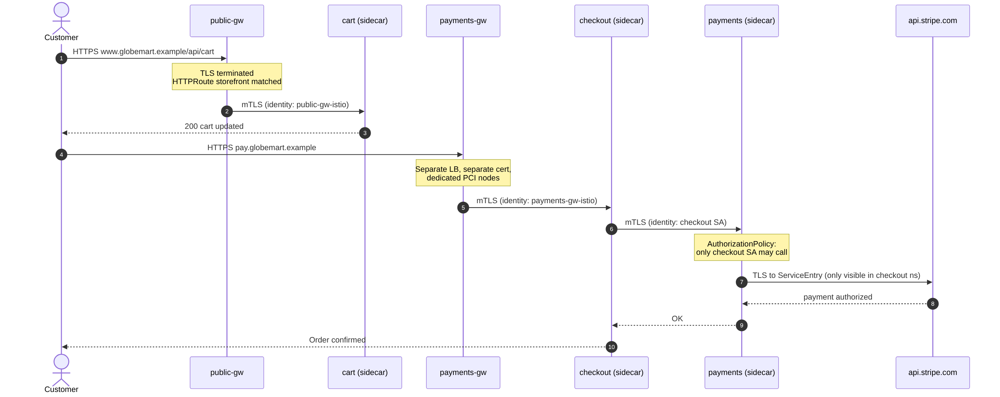

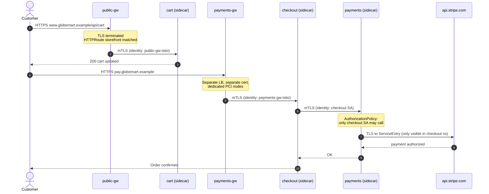

Every hop inside the cluster is **mutually authenticated**, and each service knows *who* is calling it, based on a cryptographic identity (SPIFFE ID derived from the ServiceAccount), not an IP address.

---

## 7. Splitting apps inside the mesh: zero trust between teams

Separate gateways protect the **edges**. But if `catalog` gets compromised, can it call `payments` directly? On a flat Kubernetes network, yes. Let's fix that.

### 7.1 Enforce mTLS everywhere

```yaml
# file: 30-mtls-strict.yaml
apiVersion: security.istio.io/v1
kind: PeerAuthentication
metadata:
  name: default
  namespace: istio-system      # root namespace = applies mesh-wide
spec:
  mtls:
    mode: STRICT
```

> Roll this out with `PERMISSIVE` first if some clients are not in the mesh yet; `STRICT` rejects any plaintext connection.

### 7.2 Default-deny, then allow explicitly

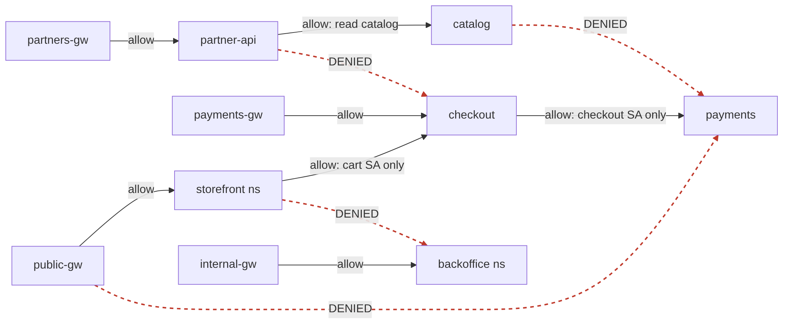

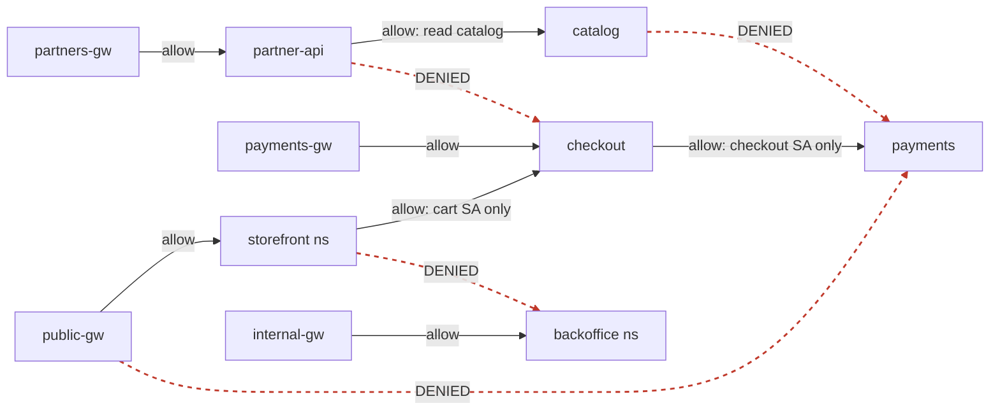

An `AuthorizationPolicy` with an empty `spec` means **deny everything** in its namespace. Then we open exactly what's needed:

```yaml
# file: 31-authz.yaml
# ---------- default deny in every app namespace ----------
apiVersion: security.istio.io/v1
kind: AuthorizationPolicy
metadata: { name: deny-all, namespace: storefront }
spec: {}
---
apiVersion: security.istio.io/v1
kind: AuthorizationPolicy
metadata: { name: deny-all, namespace: checkout }
spec: {}
---
apiVersion: security.istio.io/v1
kind: AuthorizationPolicy
metadata: { name: deny-all, namespace: partners }
spec: {}
---
apiVersion: security.istio.io/v1
kind: AuthorizationPolicy
metadata: { name: deny-all, namespace: backoffice }
spec: {}
---
# ---------- storefront: from its gateway, from itself, partners -> catalog ----------
apiVersion: security.istio.io/v1
kind: AuthorizationPolicy
metadata: { name: allow-storefront, namespace: storefront }
spec:
  action: ALLOW
  rules:
    - from:
        - source:
            principals:
              - cluster.local/ns/istio-ingress-public/sa/public-gw-istio
    - from:
        - source:
            namespaces: ["storefront"]
---
apiVersion: security.istio.io/v1
kind: AuthorizationPolicy
metadata: { name: allow-partners-read-catalog, namespace: storefront }
spec:
  selector:
    matchLabels: { app: catalog }
  action: ALLOW
  rules:
    - from:
        - source:
            principals: ["cluster.local/ns/partners/sa/partner-api"]
      to:
        - operation:
            methods: ["GET"]          # partners can read, never write
---
# ---------- checkout: only payments-gw and the storefront cart ----------
apiVersion: security.istio.io/v1
kind: AuthorizationPolicy
metadata: { name: allow-checkout, namespace: checkout }
spec:
  selector:
    matchLabels: { app: checkout }
  action: ALLOW
  rules:
    - from:
        - source:
            principals:
              - cluster.local/ns/istio-ingress-pci/sa/payments-gw-istio
              - cluster.local/ns/storefront/sa/cart
---
# ---------- payments: ONLY checkout may call it ----------
apiVersion: security.istio.io/v1
kind: AuthorizationPolicy
metadata: { name: allow-payments, namespace: checkout }
spec:
  selector:
    matchLabels: { app: payments }
  action: ALLOW
  rules:
    - from:
        - source:
            principals: ["cluster.local/ns/checkout/sa/checkout"]
      to:
        - operation:
            methods: ["POST"]
            paths: ["/v1/charges", "/v1/refunds"]
---
# ---------- partners & backoffice: only from their gateway ----------
apiVersion: security.istio.io/v1
kind: AuthorizationPolicy
metadata: { name: allow-partners-gw, namespace: partners }
spec:
  action: ALLOW
  rules:
    - from:
        - source:
            principals:
              - cluster.local/ns/istio-ingress-partners/sa/partners-gw-istio
---
apiVersion: security.istio.io/v1
kind: AuthorizationPolicy
metadata: { name: allow-internal-gw, namespace: backoffice }
spec:
  action: ALLOW
  rules:
    - from:
        - source:
            principals:
              - cluster.local/ns/istio-ingress-internal/sa/internal-gw-istio
```

> 💡 **Test before you enforce.** Add the annotation `istio.io/dry-run: "true"` to a policy: Istio logs what it *would* deny without blocking anything. Do this for a few days in production before you remove it.

> ⚠️ Each app needs its **own ServiceAccount** (`cart`, `checkout`, `partner-api`, and so on). If everything runs as `default`, identity-based policies can't tell your apps apart.

### 7.3 Control what leaves the cluster

With `REGISTRY_ONLY`, `payments` can't reach Stripe until we declare it. The `exportTo: ["."]` field makes the declaration visible **only inside `checkout`**. A compromised `catalog` pod can't even resolve a route to the payment provider.

```yaml
# file: 32-egress.yaml
apiVersion: networking.istio.io/v1
kind: ServiceEntry
metadata:
  name: stripe
  namespace: checkout
spec:
  hosts: ["api.stripe.com"]
  location: MESH_EXTERNAL
  resolution: DNS
  ports:
    - number: 443
      name: tls
      protocol: TLS
  exportTo: ["."]          # visible to the checkout namespace only
```

### 7.4 Shrink what each namespace sees

By default every sidecar receives config for *every* service in the mesh. On a big cluster that's memory and CPU wasted, plus more than each app needs to know. A `Sidecar` resource limits a namespace's view:

```yaml
# file: 33-sidecar-scope.yaml
apiVersion: networking.istio.io/v1
kind: Sidecar
metadata:
  name: default
  namespace: storefront
spec:
  egress:
    - hosts:
        - "./*"               # its own namespace
        - "checkout/*"        # cart -> checkout
        - "istio-system/*"
---
apiVersion: networking.istio.io/v1
kind: Sidecar
metadata:
  name: default
  namespace: checkout
spec:
  egress:
    - hosts:
        - "./*"               # includes the Stripe ServiceEntry
        - "istio-system/*"
```

---

## 8. Bonus: canary releases with the same building blocks

GlobeMart wants to ship `cart` v2 without a big-bang deployment. Two Kubernetes Services (`cart-v1`, `cart-v2`) and a weighted route are all it takes:

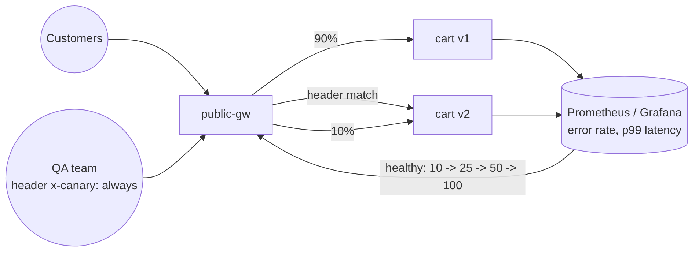

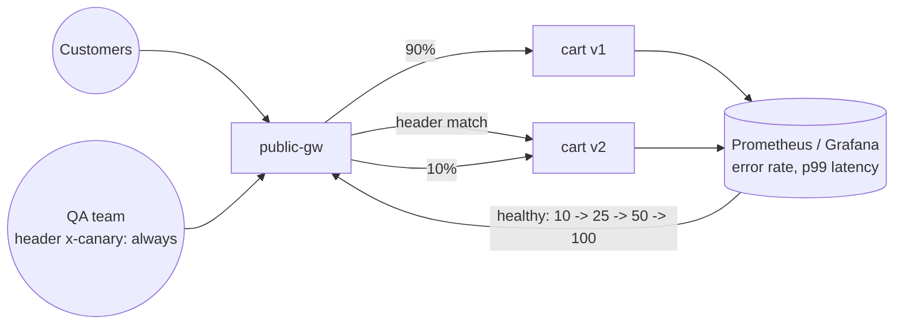

```yaml
# file: 40-canary-cart.yaml
apiVersion: gateway.networking.k8s.io/v1
kind: HTTPRoute
metadata:
  name: cart-canary
  namespace: storefront
spec:
  parentRefs:
    - name: public-gw
      namespace: istio-ingress-public
      sectionName: https
  hostnames: [api.globemart.example]
  rules:
    # 1) internal testers always get v2
    - matches:
        - path: { type: PathPrefix, value: /api/cart }
          headers:
            - name: x-canary
              value: always
      backendRefs:
        - { name: cart-v2, port: 8080 }
    # 2) everyone else: weighted split
    - matches:
        - path: { type: PathPrefix, value: /api/cart }
      backendRefs:
        - { name: cart-v1, port: 8080, weight: 90 }
        - { name: cart-v2, port: 8080, weight: 10 }
```

> If you apply this, remove the `/api/cart` rule from the `storefront` route in section 5.2 so only one route owns that path. Change the weights step by step while you watch error rates and latency. Rollback is one `kubectl apply` away. Tools like Argo Rollouts or Flagger can automate this using the same Gateway API resources.

---

## 9. Observability: see the zones you just built

Install Kiali, Prometheus and Grafana (or plug Istio metrics into your existing stack). Kiali draws the live graph of who talks to whom, which is the best way to **verify** that your isolation actually works.

Key signals to alert on, **per gateway**:

- `istio_requests_total{response_code=~"5.."}` by `source_workload` (each gateway is its own workload, so its alerts are separate too)
- p99 latency from `istio_request_duration_milliseconds_bucket`
- `403` responses with `response_flags` showing RBAC denials, which tell you a policy is blocking something (expected or not)
- Gateway HPA replicas versus their maximum, which warns you before a gateway saturates

Because each gateway is its own Deployment, a Black-Friday storm on `public-gw` shows up on **its own dashboard**, and you can see right away that `payments-gw` is unaffected.

---

## 10. Production checklist

**Lifecycle**
- [ ] Pin the Istio version; upgrade with **revisions** (`istio.io/rev` labels) for canary control-plane upgrades instead of upgrading in place.
- [ ] Track Istio's support window: each minor release is supported for about 6 weeks after the N+2 release, so plan an upgrade every quarter or two.

**Gateways**
- [ ] At least 2–3 replicas, an HPA and a PodDisruptionBudget for each gateway.
- [ ] Spread gateway pods across zones (topology spread constraints).
- [ ] Certificates managed by cert-manager, **one certificate per trust zone** (no shared wildcard for PCI).
- [ ] `allowedRoutes` set on **every** listener; never `from: All` in production.
- [ ] Graceful shutdown: give gateways enough `terminationGracePeriodSeconds` to drain connections during rollouts.

**Security**
- [ ] `PeerAuthentication` STRICT mesh-wide.
- [ ] `deny-all` in every app namespace plus explicit ALLOW policies; validate with `istio.io/dry-run` first.
- [ ] One ServiceAccount per app.
- [ ] `outboundTrafficPolicy: REGISTRY_ONLY` plus `ServiceEntry` resources with a narrow `exportTo`.
- [ ] RBAC: app teams may create `HTTPRoute` resources in their own namespaces but not `Gateway`, `PeerAuthentication` or mesh-wide policies.

**Operations**
- [ ] `istioctl analyze -A` in CI on every manifest change.
- [ ] Access logs (JSON) shipped to your log platform.
- [ ] Runbooks: "a route is rejected", "a 403 RBAC denied", "a gateway is saturated".

---

## 11. Common pitfalls (we hit most of them)

1. **Wildcard hostnames on a shared listener.** `*.globemart.example` on `public-gw` matches `pay.globemart.example` too. Without a namespace selector, any team could publish there. `allowedRoutes` is not optional.
2. **Default deny on day one in production.** Health checks, Prometheus scraping and jobs talking across namespaces all break at once. Use dry-run, read the logs, then enforce.
3. **Everything running as the `default` ServiceAccount.** Identity-based policies become meaningless.
4. **Forgetting non-HTTP traffic.** Databases and Kafka going through the mesh need correct port naming (`appProtocol` or a `tcp-` prefix), or Istio treats the traffic as opaque.
5. **Switching to `REGISTRY_ONLY` blindly.** Apps quietly call telemetry SaaS endpoints, OS package mirrors and cloud APIs. Inventory those calls first.
6. **One gateway per app.** Splitting is good, over-splitting isn't: 60 load balancers mean 60 bills, 60 certificates and 60 dashboards. Group by **trust zone and audience**, not by microservice.

---

## 12. Rolling this out on an existing cluster

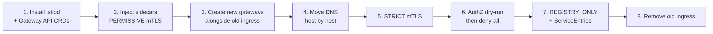

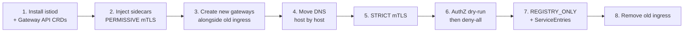

The golden rule: **every step is reversible on its own**. Running the new gateways *next to* the old ingress and moving DNS one hostname at a time (with a low TTL) means you never have a big-bang cutover.

---

## Conclusion

Istio gateways aren't just "an ingress with extra steps". Used deliberately, they become **the map of your trust zones**:

- **Group** apps that share an audience and risk level behind one gateway.
- **Split** what must stay isolated (payments, partners, internal tools) onto dedicated gateways, load balancers, certificates and even nodes.
- Let the **Gateway API's `allowedRoutes`** enforce who may publish where, so platform teams keep control while app teams keep autonomy.
- Close the inside with **mTLS + AuthorizationPolicy + scoped egress**, so a breach in one zone stays in that zone.

Same cluster, same Istio, but a very different blast radius.

*If this was useful, follow me for the next part: taking this design multi-cluster and multi-region with Istio's east-west gateways.*

---

*All manifests from this article are grouped by file name (`# file:` headers) so you can apply them in order: `00-` namespaces, `1x-` gateways, `2x-` routes, `3x-` security, `40-` canary.*
